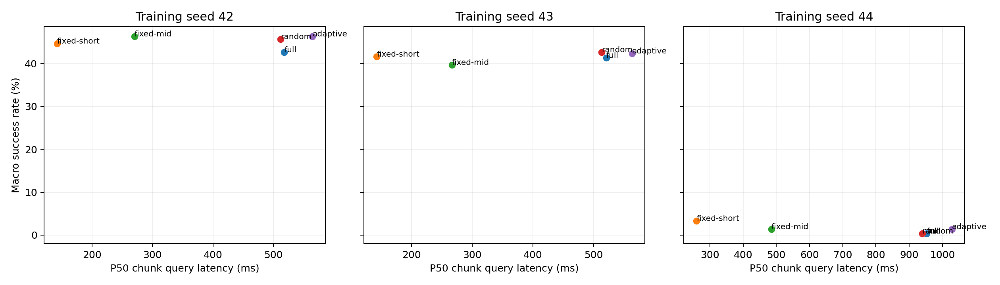

# OAT Adaptive VLA

**面向轻量视觉语言动作模型的自适应动作解码与闭环评测**

`SmolVLM2-500M` · `OAT` · `LIBERO-Goal` · `LoRA` · `PyTorch` · `Slurm`

在机器人策略推理中，生成更少的动作 token，能否真正换来更快的决策？本项目围绕这一问题，实现了基于动作前缀稳定性的提前停止策略，并搭建从模型训练、预算对照到仿真评测和统计分析的实验流程。

项目完成了 **3 个独立策略训练种子、10 个操作任务、4,500 次主测试及 1,500 次消融评测**，同时记录成功率、查询延迟、实际模型前向次数和失败证据。

[实验报告](results/formal/report.md) · [实验结果](RESULTS_PROGRESS.md) · [失败分析](results/formal/failure-analysis.md) · [复现说明](REPRODUCING.md)

## 项目实现

### 1. 自适应动作解码

在 OAT 生成过程中，对连续动作前缀的变化进行检查。当动作变化满足冻结的稳定性阈值，并通过夹爪状态保护条件时，提前结束 token 生成。

- 保持预测长度 **H=16**、执行长度 **E=8**，仅改变解码预算。
- 使用训练数据确定动作尺度，在开发集上选择并冻结停止阈值。
- 加入夹爪保护，避免仅依据连续运动量判断动作已稳定。
- 记录实际生成步数、前向次数、前缀 codec 调用与同步耗时。

### 2. 可配对的评测体系

实现 Full、Fixed-short、Fixed-mid、Random 与 Adaptive 五种策略，按相同任务和初始状态逐回合比较。

- 开发初始状态固定为 **0–9**，测试固定为 **10–39**。
- 三个种子独立训练，使用共享 codec 与固定数据划分。
- 随机预算分布只在开发阶段确定，不根据测试结果重新匹配。
- 额外评估夹爪保护与阈值敏感性，并在同一 GPU 上运行消融参照。

### 3. 实验工程与证据追踪

实现 Slurm 单 GPU 顺序执行、checkpoint 恢复、阶段结果验证和报告导出。对评测器的初始状态分配、重置行为、精度转换和实际执行动作记录进行了适配与检查。

每个正式回合关联成功标志、实际初始状态、执行步数及视频记录；每次策略查询记录生成预算、预测动作与计时信息。统计阶段进一步核验独立权重、逐回合覆盖和 GPU 对照条件。

## 实验配置

| 配置 | 设置 |
|---|---|
| 基础模型 | SmolVLM2-500M |
| 训练方式 | LoRA rank 16，冻结视觉编码器 |
| 仿真基准 | LIBERO-Goal，10 个任务 |
| 示范数据 | 328 条训练、100 条离线验证，完整 episode 划分 |
| Codec | 共享 OAT codec，10,000 个训练步 |
| 策略训练 | 种子 42 / 43 / 44，各 5,000 步 |
| 固定预算 | 16 / 4 / 8 个 token block |
| 主测试 | 5 方法 × 3 种子 × 10 任务 × 30 状态 |
| 消融 | 完整/自适应参照、去夹爪保护、阈值 ×0.5 / ×2 |

这是缩小训练预算下的实验，不等同于上游论文完整训练配方的复现。

## 实验结果

下表为三个训练种子的平均成功率，每种方法共 900 个测试回合。

| 方法 | 成功率 |
|---|---:|
| Full | 28.11% |
| Fixed-short | 29.89% |
| Fixed-mid | 29.11% |
| Random | 29.56% |
| **Adaptive** | **30.00%** |



Adaptive 的观察成功率比 Full 高 **1.89 个百分点**，但查询 P50 延迟在三个种子内均增加约 **8%–9%**，没有实现预期加速。成功率差值不直接代表统计显著提升，配对 bootstrap 区间见 [统计汇总](results/formal/summary.json)。

这一结果揭示了实际实现中的成本约束：提前停止节省的生成计算，需要覆盖稳定性检查与额外前缀解码的成本。项目因此同时报告成功率、延迟和调用次数，而不是将 token 减少直接视为推理加速。


## 代码结构

```text
scripts/
  adaptive.py                 # 停止规则、随机预算与同步计时
  pipeline.py                 # 正式训练、校准、测试与消融
  evidence.py                 # 逐回合与实际动作证据检查
  paired_statistics.py        # 消融配对统计
  failure_analysis.py         # 失败审查记录核验
  report.py                   # 统计报告与图表生成
results/
  episodes/                   # 6,000 条正式评测记录
  formal/                     # 汇总、统计区间、报告与图表
outputs/video-review/         # 配对视频抽帧
licenses/                     # 上游 LICENSE 与 NOTICE
```

环境、依赖和集群运行说明见 [REPRODUCING.md](REPRODUCING.md)。公开仓库不包含完整权重、原始视频、输入观察及全部动作轨迹；部分证据引用指向独立研究归档。尚未完成全新环境的端到端复跑，因此本仓库不是已经验证的一键复现包。

## 当前状态与限制

- **全部量化实验已完成。** 主测试与消融共 6,000 回合，结果已导出。
- 三个训练种子不足以支持强泛化或等价性结论；失败视频采用目的抽样，不能估计总体失败原因比例。
- 查询延迟包含预处理、生成、停止判断和 codec 调用，不包含外围控制器与调试文件写入；结果来自仿真，不代表真机实时控制收益。

## 基础组件与致谢

本项目基于 Praxis 的 OAT 实现、SmolVLM2 和 LIBERO 构建。项目实现聚焦自适应停止、预算对照、评测适配、实验编排和证据分析；基础模型、原始算法实现、数据与仿真器归属于上游项目。

来源、许可与实现辅助说明见 [THIRD_PARTY.md](THIRD_PARTY.md)，原始许可证及版权声明保存在 `licenses/`。
